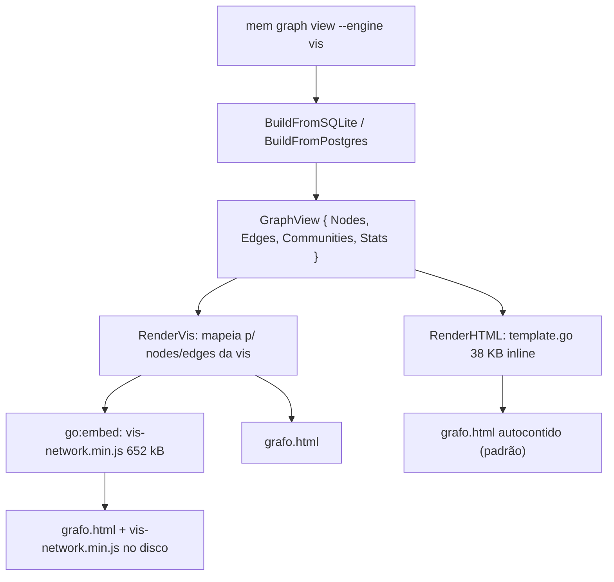

# Renderizador vis-network — Design

**Spec**: `.specs/features/graph-view-vis-engine/spec.md`
**ADR**: `docs/adr/058-renderizador-vis-network-vendorizado-sem-build-step.md`
**Status**: Draft

> **Aprovação de abordagem**: a referência de Design exige confirmar a abordagem escolhida
> antes de detalhar componentes. O dono delegou explicitamente ("faça como preferir"), o
> que constitui essa confirmação. A abordagem recomendada abaixo foi adotada.

---

## Decisões de projeto consultadas antes de escolher

`.specs/STATE.md` `## Decisions` foi lido integralmente antes de qualquer escolha
arquitetural, conforme a Design reference exige.

| Decisão ativa | Relação com esta feature |
|---|---|
| **AD-014** PageRank ponderado | Conformar — o PageRank continua calculado em Go e injetado como propriedade do nó |
| **AD-022** comunidades LPA + modularidade Q | Conformar — **não** usar o clustering da vis, que não produz Q |
| **AD-030** deep linking | Conformar — clique no nó reutiliza `internal/deeplink` |
| **AD-037 / AD-038** (obsoletas) | Precedente: viewers já foram tentados e revertidos |
| **AD-046** padrão "Deferred Until" | Precedente de como o projeto trata fallback opcional |

**Nenhuma decisão ativa conflita.** O caminho é **conformar**, e nenhuma entrada
`superseded` é criada em STATE.md. O novo registro é **AD-058**, uma adenda — não uma
substituição.

---

## Abordagens consideradas

Todas entregam a mesma coisa: um segundo renderizador de grafo, opt-in, sem build step.

### A — vis-network vendorizado com `go:embed` ✅ Escolhida

O binário carrega `vis-network.min.js` via `go:embed`. `mem graph view --engine vis
--out g.html` escreve **dois arquivos**: `g.html` e `vis-network.min.js` ao lado, a partir
dos bytes embutidos. O par é portátil e abre offline.

- ✅ Física, zoom, pan e seleção de vizinhança prontos e bons
- ✅ `go:embed` garante que o binário distribuído já funciona — sem passos extras
- ✅ O par emitido é autocontido: copiar a pasta e abrir funciona
- ✅ Versão pinada com SHA-256; um teste falha se o arquivo divergir
- ❌ +652 kB no binário
- ❌introduz uma dependência de runtime de terceiros num projeto sem nenhuma

### B — vis-network via CDN

- ✅ HTML emitido com ~10 KB, nada versionado
- ❌ **Quebra a garantia central do projeto**: o artefato deixa de abrir offline
- ❌ O pin de versão vira um pin de URL que pode mudar de conteúdo
- ❌ Reintroduz exatamente o que o revert de `b477200` eliminou

### C — SVG puro gerado em Go, sem JS de terceiros

- ✅ Zero dependência, HTML de ~8 KB, sempre offline
- ✅ Sem superfície de terceiros para auditar
- ❌ Reimplementa física de forças, zoom e pan que a vis faz bem
- ❌ É a opção que produz mais código nosso para manter

**Escolha: A.** B é rejeitada porque contradiz o propósito declarado do projeto (local,
offline, sem rede). C é rejeitada porque reimplementa o que a biblioteca resolve — e o
histórico de `b477200` mostra que código de viewer nosso não se sustenta.

---

## Arquitetura



O `GraphView` é o contrato estável. Os dois renderizadores consomem o mesmo modelo;
`builder.go` não muda.

---

## Code Reuse Analysis

### Componentes existentes a usar

| Componente | Localização | Como usar |
|---|---|---|
| `GraphView` | `internal/graphview/model.go` | Contrato de dados; **não muda** |
| `BuildFromSQLite` / `BuildFromPostgres` | `internal/graphview/builder.go` | Já abrem SQLite **e** Postgres; reaproveitado sem alteração |
| `GetColorForCommunity` / `GetColorForType` | `internal/graphview/model.go:91,100` | Paleta e cores categóricas; é ela que dá a cor do nó |
| `FindCommunityLeader` / `FindDominantType` | `internal/graphview/builder.go:380,397` | Rótulo e tipo de cada comunidade |
| `internal/deeplink` | `internal/deeplink/deeplink.go` | Emissor de `obsidian://` para o clique no nó |
| `printHelp` + guard test | `cmd/mem/main.go`, `cmd/mem/help_test.go` | Padrão de flag + teste que falha em comando não documentado |
| Escaping do template | `internal/graphview/template.go` | `{{ .DataJSON }}` — **reusar**, não reescrever à mão |

### Pontos de integração

| Sistema | Método |
|---|---|
| SQLite / Postgres | Já coberto por `BuildFromSQLite` / `BuildFromPostgres` — sem mudança |
| Schema do banco | **Nenhuma** — a feature não toca banco |
| `mem graph view` CLI | Nova flag `--engine`, padrão inalterado |

**Achado principal:** o mapeamento para vis-network é quase 1:1 e **`builder.go` não é
tocado**. É por isso que a feature é pequena apesar de parecer grande.

---

## Componentes

### Asset embutido

- **Purpose**: tornar a biblioteca disponível sem rede e sem instalação
- **Localização**: `internal/graphview/assets/`
- **Artefatos**: `vis-network.min.js` (652 kB), `LICENSE-vis-network.txt`, `PROVENANCE.md`
- **Dependências**: nenhuma
- **Reusa**: nada — é o único componente novo que não deriva de código existente

> **Não vendorizar** `vis-network.min.js.map` (1,74 MB): só é usado pelo devtools, e
>assentado num repo sem toolchain de JS é peso morto.

### `RenderVis`

- **Purpose**: renderizar um `*GraphView` como HTML vis-network
- **Localização**: `internal/graphview/vis_template.go`
- **Interfaces**:
  - `RenderVis(gv *GraphView, opts VisOptions) (html []byte, err error)`
  - `VisOptions{ PhysicsAuto bool; DataJSON []byte; Version string }`
- **Dependências**: bytes embutidos de `vis-network.min.js`
- **Reusa**: o escaping e a estrutura de dados de `template.go`

### Flags em `mem graph view`

- **Localização**: `cmd/mem/graph.go` (hoje a flag vive em `main.go`)
- **Interfaces**: `--engine <default|vis>`
- **Reusa**: o guard test de `printHelp`

---

## Mapeamento de dados

```go
// graphview.Node → nó vis
{ id: n.ID, label: n.Title, color: corDe(n), value: n.Radius,
//   pageRank: n.PageRank, communityID: n.CommunityID, isRoot: n.IsRoot }

// graphview.Edge → aresta vis
{ from: e.Source, to: e.Target, width: e.Weight, color: e.Color }
```

`corDe(n)` = `n.Color` → senão `n.CommunityColor` → senão `GetColorForCommunity(n.CommunityID)`
→ senão o slate neutro `#64748b`. Nenhuma cor nova é inventada.

**Física**: desligada abaixo de 30 nós (posições determinísticas; para 8 nós a simulação
é ruído), ligada acima.

---

## Error Handling Strategy

| Cenário | Tratamento | O que o usuário vê |
|---|---|---|
| `--engine` com valor desconhecido | Erro de validação antes de qualquer I/O | `engine inválido "x": use "default" ou "vis"` |
| Grafo com 0 nós | Página com mensagem, não canvas vazio | "O vault não tem documentos indexados" |
| `Node.Color` e `CommunityColor` vazios | Fallback para o slate neutro | Não há nó invisível |
| Arquivo de saída em diretório inexistente | Criar ou falhar com mensagem clara | — |
| Divergência de hash do asset | **Falha de teste**, não de runtime | CI vermelho antes de gerar viewer |

---

## Riscos e Preocupações

| Preocupação | Local | Impacto | Mitigação |
|---|---|---|---|
| **Supply chain**: biblioteca de terceiros executando JS local | `internal/graphview/assets/` | Um compromised update executaria no navegador do usuário | Versão **pinada** + SHA-256 + teste que falha na divergência;upgrade e bump explícito de hash |
| **Asset não versionado na origem**: `package.json` do vis-network tem `0.0.0-no-version` | npm/semantic-release | Ler a versão do repo dá placeholder | `PROVENANCE.md` registra a versão do **dist-tag**, e o hash é a autoridade |
| **Repo cresce 652 kB** | blob do git | Clone mais pesado | Aceito: é o preço de não depender de rede. Alternativa rejeitada na tabela acima |
| **Precedente de fracasso**: viewers já foram revertidos | `b477200` | Risco de repetir | Esta feature é **opt-in**, o renderizador atual é o padrão e permanece intacto |
| **`template.go` é um arquivo Go de 38 KB com HTML inline** | `internal/graphview/template.go` | Difícil de revisar com diff | **Não escalado** — a feature adiciona um arquivo, não migra o existente |
| Sem cobertura de teste para o renderizador atual | `internal/graphview/template_test.go` (5,5 KB) | Regressão no padrão pode passar | O AC de byte-identicalidade cobre a regressão mais óbvia; cobertura do JS fica registrada como dívida |

---

## Tech Decisions

| Decisão | Escolha | Racionale |
|---|---|---|
| Como distribuir a lib | `go:embed` + escrita ao lado do HTML | Binário funciona sozinho; o par emitido é portátil |
| Onde fica o asset | `internal/graphview/assets/` versionado | Compilação recusa o binário se faltar; a dependência é explícita |
| Como o HTML acha a lib | `<script src="vis-network.min.js">` relativo | Zero origem remota (AC VIS-09) |
| Pin de versão | SHA-256 em `PROVENANCE.md`, verificado por teste | Detecta upgrade não auditado antes do viewer ser gerado |
| Renderer padrão | Inalterado (`default`) | Ninguém que usa hoje tem o output quebrado |
| Clustering | Continua o LPA de `internal/graph` | A vis agrupa mas não dá modularidade Q |
| Source map | Não vendorizado | 1,74 MB que só o devtools usa |

> **Decisão de nível de projeto**: esta feature estabelece o precedente de como uma
> dependência de frontend entra no MyMemory — **vendorizada, pinada por hash, opt-in e
> nunca por CDN**. Vou registrar isso como `AD-058` em `docs/adr/` e adicionar a entrada
> correspondente em `.specs/STATE.md` `## Decisions`.

---

## Correção que o Design impôs na spec

A spec (VIS-06, VIS-07) dizia que `go build ./...` não pode depender do asset existir. Isso
está **errado** e foi descoberto aqui: com `go:embed`, o asset é parte do binário, e é
justamente isso que faz `mem graph view --engine vis` funcionar numa máquina limpa.

Os dois ACs são reescritos: o asset passa a ser **exigido pela compilação** (é
git-tracked, então uma ausência é um erro visível), e o que continua verdade é que
**nenhuma origem remota** é emitida. A spec é corrigida antes do Tasks.