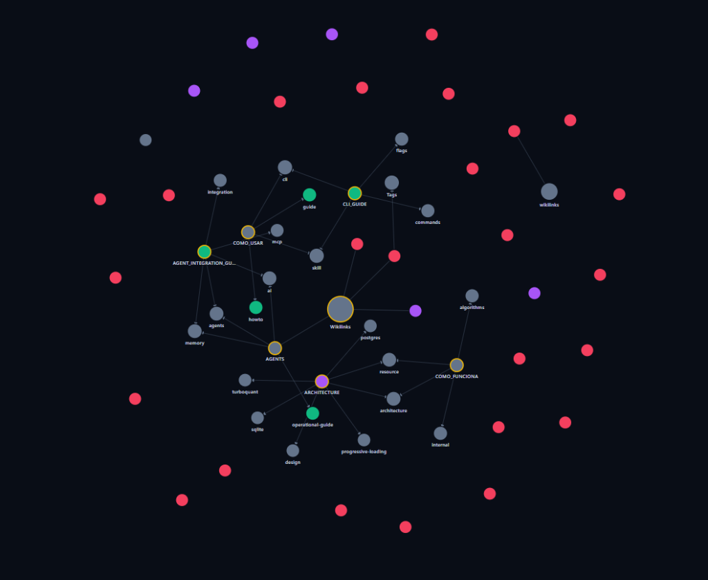

# 🧠 My-Memory

> **Transforme qualquer repositório ou vault Markdown em uma memória autoconsciente (*Repository Brain*) para você e seus Agentes de IA.**

[](https://go.dev/)
[](https://sqlite.org/)
[](https://github.com/asg017/sqlite-vec)
[](https://arxiv.org/abs/2504.19874)
[](https://modelcontextprotocol.io/)
[](LICENSE)

---

## 💡 Por que o My-Memory?

Agentes de IA (Claude Code, Cursor, Antigravity, GitHub Copilot, Windsurf) sofrem com limites de contexto e alucinações relacionais quando navegam em projetos grandes:
1. **Perda de Contexto:** Não é viável enviar centenas de arquivos para a janela de contexto sem estourar tokens e aumentar custos.
2. **Dependências Quebradas:** A IA altera um módulo sem saber quais componentes dependem dele no grafo.
3. **Decisões Esquecidas:** A IA refatora código ignorando decisões de arquitetura (ADRs) documentadas no passado.

O **My-Memory** resolve isso unificando **busca vetorial**, **grafo de conhecimento** e **busca léxica** em uma camada unificada de altíssima performance, acessível diretamente via terminal ou pelo **Model Context Protocol (MCP)**.

---

## ⚡ Arquitetura em 8 Pilares

```
                                [ Arquivos Markdown / Notas ]
                                              │
                         ┌────────────────────┴────────────────────┐
                         ▼                                         ▼
             [ Parser [[wikilinks]] & #tags ]            [ Chunking Semântico ]
                         │                                         │
                         ▼                                         ▼
               ( graph_nodes & edges )                  [ Embeddings Embutidos ]
                         │                             (MiniLM multilíngue, 384d)
                         │                                         │
                         │                         ┌───────────────┴───────────────┐
                         │                         ▼                               ▼
                         │                 [ sqlite-vec ]                 [ TurboQuant 4-bit ]
                         │                 (float32 k-NN)               (32 Reflexões Householder
                         │                         │                        + Bit-Packing)
                         │                         │                               │
                         ▼                         ▼                               ▼
       ┌───────────────────────────────────────────────────────────────────────────────────────┐
       │                              SQLite Local (memory.db)                                 │
       │  • documents         • chunks_vec (vec0)          • graph_nodes                       │
       │  • chunks            • chunks_turboquant (4-bit)  • graph_edges                       │
       │  • chunks_fts (BM25)                                                                  │
       └───────────────────────────────────────────────────────────────────────────────────────┘
                                                   ▲
                                                   │
                         ┌─────────────────────────┴─────────────────────────┐
                         ▼                                                   ▼
            [ CLI: mem search [-tq] ]                           [ Servidor MCP: mem mcp ]
             (Desenvolvedor no terminal)                           (Claude Code, Cursor, IAs)
```

1. **📦 SQLite Unificado & PostgreSQL Opcional:** Sem dependências pesadas (sem Neo4j, sem Pinecone, sem Elasticsearch). Armazena documentos, tabela virtual `sqlite-vec`, índice léxico `FTS5 (BM25)` e conexões de grafo em um arquivo local único ou em PostgreSQL corporativo com `pgvector`.
2. **🔬 TurboQuant (Google DeepMind, ICLR 2026):** Implementação pioneira em Go da quantização de 4-bits com 32 reflexões ortogonais de Householder ($R^T R = I$). Reduz o consumo vetorial em **~87%** (de 1.536 para 196 bytes por chunk) mantendo fidelidade $> 99\%$.
3. **🕸 Grafo Estilo Obsidian via SQL Recursivo:** Extrai conexões explícitas de notas (`[[links]]` e `#tags` — as tags só viram aresta quando o nome da tag casa com o título de uma nota, para não criar nós mortos, ADR-041), permitindo travessias relacionais, detecção de comunidades (LPA) e análise de raio de impacto em microssegundos.
4. **🔌 Model Context Protocol (MCP) Nativo:** Conecta-se diretamente aos assistentes de codificação de IA via `stdio` (JSON-RPC 2.0) ou rede HTTP/SSE, expondo ferramentas de busca e expansão de contexto.
5. **🏛️ Federação, Cofre Central e Wikilinks Cross-Vault:** Vincula um Cofre Central de padrões corporativos (Google Drive / OneDrive para Obsidian) a repositórios satélites com `repo_id` criptográfico imutável, catálogo global (`~/.memory/config.yaml`), zero-credentials no Git, busca híbrida federada via RRF e protocolo canônico universal `memory://<repo>/<path>` para resolução transparente de wikilinks cross-vault em editores e MCP.
6. **🌳 Code Graph do Vault de Repositório (ADR-061):** o *code graph* do repositório — parser sintático em **Go puro** (`go/parser` + `go/ast` + `go/token` da stdlib: sem CGO, sem build tag, o binário padrão já indexa código). Símbolos em `code_files`/`code_symbols` e arestas **estruturais** em `code_edges` — `calls` (com o **ponto de chamada**, arquivo:linha da expressão de chamada), `imports`, `inherits`, `uses_type` e `references`. Cada aresta carrega **proveniência** (`epistemic_status`: `EXTRACTED` quando resolvida no escopo do pacote, `INFERRED` quando resolvida só por nome) e `confidence`; o destino ambíguo vai para `code_edges_uncertain` com a razão e **nunca** vira aresta resolvida (ADR-011). As arestas **estruturais** vêm do backend AST, que hoje entende **Go**; as demais linguagens seguem no fallback determinístico da ADR-047, com arestas `references` por **igualdade de nome** (`INFERRED`) — sem ponto de chamada, e só quando outro símbolo tem o mesmo nome simples. O grafo é gravado no **engine configurado** (PostgreSQL quando o vault está no PostgreSQL, SQLite quando está no SQLite) e filtrado por `repository` (`repo_id`), como o grafo de notas. Superfície: `mem code-index`/`code-search`/`code-graph`/`code-stats` e as tools MCP `memory_code_search`/`memory_code_neighbors`, com boost RRF 2× em `qualified_name`. O ADR-047 (tree-sitter) **não** foi supersedido — o plano de deferral do binding real segue intacto.
7. **🖥️ Painel de Métricas da Memória (`viewer/`):** SPA React 19 + Vite 8 que **o próprio MCP serve** — sem processo extra, sem CDN, sem runtime de aplicação. Cinco visões: Health Score e prontidão, hubs e comunidades do grafo, leitura de notas com `[[wikilinks]]` navegáveis, drift semântico e o **code graph** (rota `/code`: símbolos de um repositório e seus vizinhos estruturais, com o tipo da aresta e o ponto de chamada). Build estático local, publicado em `.mymemory/www/app/` (ADR-059, ADR-060).
8. **🏷️ Superfície de Tags do Obsidian:** A tag deixa de ser descartada na indexação e vira **dado consultável**: a tabela `document_tags` guarda cada tag do documento, inclusive a órfã, gravada **antes** da resolução fuzzy (ADR-055). A superfície expõe `mem tags` (inventário), `mem tag <nome>` (a tag e suas descendentes), `mem search --tag <tag>` (filtro push-down da busca) e as tools MCP `memory_get_tags` e `memory_get_tag`. A aresta `tagged_as` do grafo continua sendo criada **só** para as tags resolvidas — a tabela não reinstala o nó morto que a ADR-041 eliminou.

---

## 📊 Eficiência TurboQuant (Google DeepMind, ICLR 2026)

Para um vetor de 384 dimensões (`paraphrase-multilingual-MiniLM-L12-v2`, provider embutido — ADR-035):

| Formato | Precisão | Bytes / Chunk | Redução de Espaço | Fidelidade Angular |
| :--- | :--- | :--- | :--- | :--- |
| **Float32 Padrão** | 32-bit float | 1.536 bytes | Linha de Base | 100.0% |
| **Int8 Clássico** | 8-bit int | 384 bytes | ~75.0% | ~95.0% (sensível a outliers) |
| **TurboQuant 4-bit** | 4-bit packed | **196 bytes** | **~87.2%** | **> 99.0%** (ortogonalmente protegido) |

---

## ⚡ Instalação Rápida (1 Comando)

Instale a versão oficial compilada do **My-Memory** em segundos, com integridade criptográfica **SHA-256** verificada e configuração automática de PATH (sem requerer Go instalado):

#### Windows (PowerShell)
```powershell
irm https://raw.githubusercontent.com/FelipeMiiller/my-memory/main/scripts/install.ps1 | iex
```

#### Linux & macOS (POSIX Shell)
```bash
curl -fsSL https://raw.githubusercontent.com/FelipeMiiller/my-memory/main/scripts/install.sh | sh
```

> **Opção via Go Toolchain:** Se você possui Go $\ge$ 1.22 instalado:
> ```bash
> go install github.com/FelipeMiiller/my-memory/cmd/mem@latest
> ```

---

## 🚀 Início Rápido (Quickstart)

### 1. Inicializar o Vault no seu Projeto
Na pasta raiz do seu repositório de código ou vault de notas:
```bash
mem init
```
*(Gera a pasta `.memory/` com `repo_id`, escopo de pastas, `.gitignore` seguro e registra no catálogo global)*.

### 2. Configurar Cofre Central e Preferências Globais (Opcional)
```bash
mem setup
```
*(Assistente interativo que conecta seu Google Drive/OneDrive e grava em `~/.memory/config.yaml`)*.

### 3. Auto-Configurar Clientes de IA
```bash
mem install
```
*(Configura automaticamente Claude Desktop, Cursor, VS Code e Windsurf para se conectarem ao seu vault via MCP)*.

### 4. Indexar e Buscar
```bash
# Indexar notas com cache incremental SHA-256
mem index

# Busca híbrida federada (Local + Central via RRF)
mem search "como funciona o cache incremental?"
```

### 5. Indexar o Code Graph e Registrar Lições
```bash
# Code graph do repositório (símbolos + arestas estruturais).
# Roda dentro do `mem index` quando há escopo de código no .memory/config.yaml,
# ou de forma cirúrgica:
mem code-index --json

# Registrar uma lição aprendida no cofre central (a memória de aprendizagem):
mem lesson "Cache incremental só reindexa o que mudou" \
  --summary "O cache SHA-256 evita reindexar notas inalteradas"
```

> [!note]
> O My-Memory separa **dois conceitos de memória** (ADR-061): o **Cofre Central**,
> onde vive a aprendizagem (notas Markdown Obsidian, como as lições do
> `mem lesson`), e o **Vault de Repositório**, onde vive o code graph do código
> (`mem code-index`). O motor é o mesmo em ambos — busca híbrida FTS + TurboQuant
> + RRF, `epistemic_status`, PageRank e blast radius.

---

## 🌐 Visualizador Interativo de Grafo (`graph.html`)

O My-Memory gera um **visualizador interativo de grafo em HTML/SVG standalone** (Zero-CDN, sem internet ou dependências de bibliotecas externas). Ele transforma todas as conexões de notas Markdown, `[[wikilinks]]`, tags `#` e decisões arquiteturais em uma teia visual navegável em tempo real no seu navegador:

<p align="center">
  
</p>

### 🔍 O que a visualização revela:
- **Autoridade e Centralidade Estrutural (PageRank & God Nodes)**: O tamanho dos círculos é proporcional à autoridade estrutural calculada via **PageRank Ponderado** (ADR-014). Hubs centrais como `Wikilinks`, `ARCHITECTURE`, `AGENTS`, `COMO_USAR` e `CLI_GUIDE` emergem naturalmente como referências estruturais do repositório.
- **Clusters e Comunidades Semânticas (LPA)**: As cores dos nós refletem agrupamentos conceituais gerados pelo **Label Propagation Algorithm (LPA)** ponderado com cálculo de **Modularidade Newman-Girvan** (ADR-022), revelando subsistemas e domínios de conhecimento interligados.
- **Arestas Semânticas & Relações**: Linhas direcionadas demonstram fluxos de dependência e referências cruzadas (`links_to`, `tagged_as`, dependências técnicas).
- **Detecção Visual de Órfãos & Dead Links**: Nós periféricos (em tons avermelhados/magenta desconectados) representam notas isoladas ou referências quebradas, funcionando como uma auditoria visual complementar ao `mem doctor` (ADR-013).
- **Inspeção Cirúrgica em 3 Colunas (Triptych Node Inspector - ADR-024)**: Ao clicar em qualquer nó no gráfico interativo, abre-se um modal retrátil com visão cirúrgica completa:
  1. *Coluna 1 (Inbound)*: Notas e dependentes chamadores classificados por risco e PageRank.
  2. *Coluna 2 (Centro)*: Metadados canônicos, score de *Blast Radius* e preview de conteúdo seguro.
  3. *Coluna 3 (Outbound)*: Referências de saída com verificação ativa de integridade e atalho para abrir diretamente no Obsidian (`obsidian://open?file=...`).

### 🕹️ Como Gerar e Abrir:
```bash
# 1. Gerar e abrir automaticamente no navegador padrão
./bin/mem.exe graph view --open

# 2. Exportar para um arquivo HTML específico
./bin/mem.exe export --html graph.html

# 3. Via ferramenta MCP para Agentes de IA
# A tool memory_visualize_graph compila e salva o grafo instantaneamente.
```

---

## 🖥️ Painel de Métricas da Memória (`viewer/`)

O mesmo binário que serve o MCP também serve um **painel web local**. Não é um
aplicativo desktop nem um servidor extra: é build estático, servido pelo
transporte HTTP do MCP a partir de `.mymemory/www/`, sem CDN e sem origem
remota (ADR-059, ADR-060).

```bash
# 1. Compilar a viewer e publicar o build na raiz servida
make viewer

# 2. Subir o MCP com transporte HTTP
./bin/mem.exe mcp --port 38400
```

Abra **http://127.0.0.1:38400/**.

| Visão | O que mostra | Tools MCP |
| :--- | :--- | :--- |
| **Overview** | Prontidão do servidor e Health Score do grafo, com dead links, órfãs e self-loops | `GET /health`, `memory_doctor` |
| **Grafo** | Hubs por grau e por PageRank, comunidades detectadas por LPA com modularidade, e conexões latentes | `memory_get_hubs`, `memory_get_clusters`, `memory_get_insights` |
| **Notas** | Lista indexada com filtro, estrutura de títulos, metadados de arquivo e **leitura da nota com `[[wikilinks]]` navegáveis** | `memory_list_files`, `memory_read_note`, `memory_note_outline`, `memory_file_metadata` |
| **Drift** | Documentação defasada, código sem cobertura, blast radius e caminho entre dois nós | `memory_get_drift`, `memory_get_impact`, `memory_find_path` |
| **Código** | Símbolos de um repositório e seus vizinhos estruturais, com o **tipo da aresta** (`calls`, `imports`, `inherits`, `uses_type`, `references`) e o **ponto de chamada** | `memory_code_search`, `memory_code_neighbors` |

O botão **Abrir grafo interativo** em cada visão invoca `memory_visualize_graph`
e abre a URL servida do artefato — a mesma que o agente recebe.

> [!warning]
> O transporte HTTP do MCP **não tem autenticação** (lacuna pré-existente,
> registrada na ADR-021 e na ADR-050). O bind padrão é loopback
> (`127.0.0.1`). **Não exponha a porta em uma rede não confiável** sem um
> reverse proxy com autenticação.

---

## 📚 Navegação da Documentação

Para mergulhar nos detalhes operacionais, matemáticos e de integração, consulte os guias dedicados:

| Guia | Para quem é | Descrição |
| :--- | :--- | :--- |
| 📖 [**`COMO_USAR.md`**](COMO_USAR.md) | **Desenvolvedores** | Manual prático de comandos CLI, exemplos de busca, configuração de PostgreSQL/SQLite e monitoramento em tempo real. |
| 🔍 [**`COMO_FUNCIONA.md`**](COMO_FUNCIONA.md) | **Engenheiros & Arquitetos** | Explicação profunda da arquitetura, matemática do TurboQuant, algoritmo RRF, CTEs recursivas e ciclo de vida do cache. |
| 🤖 [**`AGENT_INTEGRATION_GUIDE.md`**](docs/AGENT_INTEGRATION_GUIDE.md) | **Agentes de IA & Integrações** | Como integrar o My-Memory com Cursor, Claude Code, Copilot e Antigravity via MCP e regras `AGENTS.md`. |
| 🏛 [**`docs/adr/`**](docs/adr/README.md) | **Decisões de Engenharia** | 60 Registros de Decisão de Arquitetura (ADRs) documentados no formato padrão MADR (o slot 052 está reservado e vazio). |
| 🧠 [**`docs/concepts/architecture.md`**](docs/concepts/architecture.md) | **Engenheiros** | Stub conceitual: visão arquitetural consolidada (camadas, decisões centrais, ADRs relacionados). |
| 🧪 [**`docs/BENCHMARKS.md`**](docs/BENCHMARKS.md) | **Engenheiros de Performance** | Metodologia, resultados consolidados e como reproduzir benchmarks (TurboQuant, RRF, indexação, grafo). |
| 🔗 [**`docs/REFERENCES.md`**](docs/REFERENCES.md) | **Pesquisadores & Curiosos** | Projetos de referência (CodeGraph, Cursor, etc.) e matriz de refinamento arquitetural. |
| 🏗 [**`docs/REPOSITORY_BRAIN.md`**](docs/REPOSITORY_BRAIN.md) | **Integradores** | Como integrar My-Memory em qualquer projeto + convention de Concept Stubs (Spec 042). |

### 📜 Documentos do Repositório

| Doc | Descrição |
| :--- | :--- |
| 🤝 [[CONTRIBUTING|CONTRIBUTING.md]] | Como contribuir (Conventional Commits, testes, PR workflow). |
| 📜 [[CODE_OF_CONDUCT|CODE_OF_CONDUCT.md]] | Pacto de convivência da comunidade. |
| 🛡 [[SECURITY|SECURITY.md]] | Política de reporte e versões suportadas. |
| 📄 [[LICENSE|LICENSE]] | Licença MIT. |

---

## 🤖 Ferramentas MCP para Assistentes de IA

Quando executado como servidor MCP (`mem mcp`), o My-Memory disponibiliza 26 ferramentas para o ecossistema de IA:

> [!tip]
> **Duas camadas na mesma resposta.** As catorze ferramentas de leitura devolvem, além do
> texto legível, o campo **`structuredContent`** — o payload estruturado definido pelo
> MCP spec 2025-06-18. O texto serve ao humano e ao LLM; o `structuredContent` serve ao
> cliente de máquina, que valida o JSON em vez de raspar texto. A forma do payload é o
> **JSON tags do tipo Go** (`internal/mcp/handlers.go`), que é a fonte da verdade.
> Tools que não o preenchem emitem exatamente o mesmo JSON de antes — o campo é omitido
> quando vazio.
>
> Ferramentas com `structuredContent`: `memory_doctor`, `memory_get_hubs`,
> `memory_get_clusters`, `memory_get_insights`, `memory_get_drift`,
> `memory_list_files`, `memory_read_note`, `memory_note_outline`,
> `memory_file_metadata`, `memory_visualize_graph`, `memory_get_tags`,
> `memory_get_tag`, `memory_code_search` e `memory_code_neighbors`.

- `memory_search`: Busca híbrida (RRF) unificando FTS, vetores e grafo com decaimento temporal opcional, que ordena por **tempo de edição** do arquivo (ADR-057). Aceita `include_code: true` (default `false`) para que os símbolos de `code_symbols` participem do fan-in RRF como fonte lexical real (com boost CA-05 em `qualified_name`) — sem a flag, o ranking é **idêntico** ao de antes; e `tag` (ADR-055) para filtrar por tag do Obsidian — a tag e as descendentes.
- `memory_get_neighbors`: Expansão recursiva de nós e dependências conectadas via SQL recursivo (CTEs) com marcação `is_federated: true`.
- `memory_find_path`: Descoberta do caminho mais curto entre duas notas via BFS bidirecional com pesos epistêmicos.
- `memory_get_impact`: Análise de raio de destruição (*Blast Radius*) e dependentes reversos com risk scoring.
- `memory_get_clusters`: Detecção de comunidades e módulos temáticos via LPA ponderado e modularidade Q.
- `memory_get_hubs`: Identificação de God Nodes e nós líderes por grau ou PageRank ponderado.
- `memory_get_insights`: Métricas globais da topologia da base de conhecimento (densidade, componentes, isolados).
- `memory_inspect_node`: Inspeção cirúrgica de nós (in-links, out-links com sinalização cross-vault, chunks quantizados e status).
- `memory_doctor`: Auditoria de integridade do grafo com detecção de dead links e notas órfãs. Também reporta quantos documentos foram indexados antes do metadado `mtime` existir.
- `memory_list_files` *(ADR-057)*: Lista os documentos indexados em ordem alfabética, com filtros opcionais de extensão e pasta.
- `memory_read_note` *(ADR-057)*: Devolve o Markdown bruto de uma nota pelo caminho do vault, sem fragmentar em chunks.
- `memory_note_outline` *(ADR-057)*: Retorna a estrutura de títulos de uma nota com o nível de cada heading, ignorando blocos de código.
- `memory_file_metadata` *(ADR-057)*: Retorna path, title, size em bytes e `mtime` da última edição de uma nota.
- `memory_get_tags` *(ADR-055)*: Lista as tags do vault com a contagem de documentos que carregam cada uma — inclusive a tag órfã, que não nomeia nenhuma nota. Aceita `path` para devolver só as tags de um documento.
- `memory_get_tag` *(ADR-055)*: Consulta uma tag e devolve a contagem e a lista das notas que a carregam — casa a tag **e as descendentes**, como o `tag:` do Obsidian.
- `memory_reconcile`: Reconciliação do vault com o índice PostgreSQL sem reindexar — remove só documentos cujo arquivo sumiu do disco (`dry_run` por padrão, aborta se o vault não existir ou se a varredura do disco retornar 0 arquivos).
- `memory_get_drift`: Auditoria de desvio semântico e divergência entre código e documentação.
- `memory_write_note`: Criação de notas atômicas estruturadas com sincronização e indexação instantâneas.
- `memory_append_section`: Adição atômica de seções a notas existentes com auto-linking e parsing.
- `memory_compile_note`: Síntese de fragmentos recuperados (*Compile-not-Retrieve*) para economia de contexto.
- `memory_pack_context`: Empacotamento de orçamento de contexto de tokens (Tier L0/L1/L2) com subgrafos Mermaid.
- `memory_visualize_graph`: Exportação de visualizador interativo em HTML/SVG standalone com física de forças. Devolve a **URL servida** do artefato (`http://127.0.0.1:38400/graph/<arquivo>.html`) e o **caminho em disco**; sem transporte HTTP ativo devolve só o caminho, sem erro (ADR-059, ADR-060).
- `memory_export_canvas`: Exportação bidirecional para o padrão Obsidian JSON Canvas 1.0 (.canvas).
- `memory_open_node`: Abertura cirúrgica de notas locais e canônicas federadas (`memory://`) no editor via deep links de IDE.
- `memory_code_search` *(ADR-061, ADR-047, CA-10)*: Busca estruturada de símbolos de código com filtros `language` e `kind`, ranqueada por boost RRF 2× em `qualified_name`. Roda com o **backend Go puro** — não exige build especial — e lê o code graph do engine configurado, filtrado por `repository`.
- `memory_code_neighbors` *(ADR-061, ADR-047, CA-11)*: Sub-grafo estrutural (in+out) de um símbolo até `depth` hops via CTE recursivo sobre `code_edges`. A resposta traz **proveniência** (`epistemic_status`: `EXTRACTED`/`INFERRED`), **confiança** (`confidence`) e o **ponto de chamada** (`call_site_file`/`call_site_line`) de cada relação — e os **documentos que citam o símbolo**, graças à ponte `references_code` entre notas e código no grafo único.

---

## 📁 Estrutura do Repositório

```text
my-memory/
├── cmd/mem/            # Ponto de entrada CLI (init, index, search, inspect, impact, drift, mcp, etc.)
├── internal/
│   ├── autowire/       # Injeção e sugestão automática de wikilinks em Markdown
│   ├── canvas/         # Conversor e exportador para formato JSON Canvas 1.0 (.canvas)
│   ├── codeast/        # Parser de código em Go puro (stdlib), arestas estruturais, cache SHA-256/ast_hash e sub-grafo de código (ADR-061)
│   ├── compiler/       # Compilador semântico de contexto e síntese sob demanda
│   ├── config/         # Configuração declarativa, descoberta de vault e variáveis de ambiente
│   ├── db/             # Schemas SQLite, virtual tables sqlite-vec e queries recursivas CTE
│   ├── deeplink/       # Integração e deep linking com editores (VS Code, Cursor, Obsidian)
│   ├── drift/          # Análise de divergência semântica e staleness entre git e documentação
│   ├── embedder/       # Provider embutido ONNX (paraphrase-multilingual-MiniLM-L12-v2, 384d) e resolução do embedder
│   ├── federation/     # Federação multirrepositório, RRF e resolução de URIs canônicas memory://
│   ├── graph/          # Algoritmos de grafo (LPA, modularidade Q, PageRank, Blast Radius, Inspector)
│   ├── graphview/      # Visualizador interativo HTML/SVG standalone com física de forças
│   ├── mcp/            # Servidor Model Context Protocol com 26 tools (stdio + HTTP/SSE) e serving estático da viewer
│   ├── parser/         # Extração de wikilinks, tags, metadados e chunking
│   ├── repo/           # Scanner de arquivos do repositório respeitando escopo e gitignore
│   ├── staleness/      # Rastreamento de desatualização temporal de notas e links quebrados
│   ├── store/          # Camada de armazenamento unificada e suporte a PostgreSQL com pgvector
│   ├── turboquant/     # Rotações ortogonais de Householder e quantização de 4-bit
│   └── watcher/        # File watcher em segundo plano com debouncing inteligente
├── docs/               # Documentação técnica detalhada e 60 ADRs
├── viewer/             # SPA do painel de métricas (React 19 + Vite 8 + TanStack), build estático servido pelo MCP
├── COMO_USAR.md        # Manual prático passo a passo para o usuário
├── COMO_FUNCIONA.md    # Explicação detalhada da arquitetura e funcionamento interno
├── AGENTS.md           # Regras operacionais para Agentes de IA
└── README.md           # Apresentação geral do projeto
```

---

## 🧪 Validação e Testes

O My-Memory conta com cobertura de testes unitários e de integração em todos os 25 pacotes Go:

```bash
# Executar todos os testes do repositório
go test -count=1 ./...

# Executar testes com relatório de cobertura
go test -v -cover ./internal/turboquant/... ./internal/graph/... ./internal/parser/...
```

A viewer tem gate próprio: `npm run typecheck && npm run test && npm run build` em
`viewer/`, com orçamento de **160 kB gzip** para o bundle (job `frontend` do CI).

---

## 📄 Licença

Distribuído sob a licença [MIT](LICENSE).
