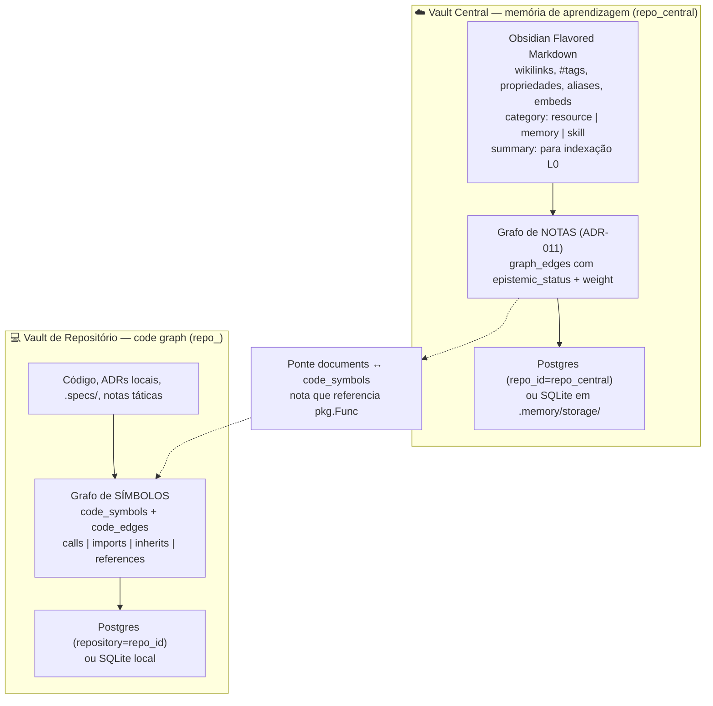

# ADR-061: Dois Conceitos de Memória — Vault Central (Aprendizagem) e Vault de Repositório (Code Graph)

- **Date**: 2026-10-23
- **Status**: Accepted
- **Deciders**: Felipe Miiller, Mavis (orchestrator)
- **Tags**: code-graph, central-vault, obsidian, tree-sitter, graphify, provenance, repository-brain, federation, cgo

## Context and Problem Statement

O `my-memory` tem **dois** conceitos de memória, e até agora eles nunca foram
declarados como tal:

1. **Memória de aprendizagem (cofre central).** Acumula o que se aprende: padrões
   de arquitetura, normas de API, diretrizes de segurança, glossário de domínio,
   lições de projeto, ADRs de decisão transversal. É consultado a partir de
   qualquer repositório. Hoje é modelada pelo **Obsidian Flavored Markdown** —
   `[[wikilinks]]`, `#tags`, propriedades de frontmatter, aliases, embeds — e
   vive no banco `repo_central` (ADR-033).
2. **Code graph (cofre de repositório).** Descreve **como o código do repositório
   se conecta**: funções, classes, imports, chamadas, implementações. É
   consultado por um agente que se orienta no repo antes de editar.

A ADR-033 já implementa a **separação** (Global Brain × Local Brain, partição por
`repo_id`, busca federada RRF anotando `[local]`/`[central]`), e a ADR-011 já
declara ter se inspirado no [Graphify-Labs/graphify](https://github.com/Graphify-Labs/graphify)
para *god nodes* e status epistêmico. O que **não** existe é o **modelo interno**
do vault de repositório: ele foi especificado como "mais notas" (ADR-047,
ADR-054) e nunca como code graph de primeira classe.

A auditoria de 2026-10-23, comparando o clone do Graphify (`v0.9.94`) com o
código do `my-memory`, mediu a distância real:

| Capacidade | Graphify | my-memory (`develop`, `35b01ed`) |
|---|---|---|
| Parser de código | tree-sitter real, ~30 linguagens | `MockParser` regex ("walker regex-by-line") |
| Arestas estruturais | `calls`/`imports`/`inherits` do AST, com **call-site** | **só `references`**, por igualdade de nome |
| Proveniência por aresta | `EXTRACTED`/`INFERRED`/`AMBIGUOUS` + `confidence_score` | `confidence` existe no schema, **não sai na resposta** |
| Busca | lexical (trigramas+IDF), sem vetor | **FTS + TurboQuant 4-bit + RRF** — superior |
| Clusters / centralidade | Leiden / grau | **LPA + modularidade Q / PageRank ponderado** — superior |
| Blast radius | `affected` (BFS reverso) | **ADR-023 `memory_get_impact`** — superior |
| Visualizador | `graph.html` via CDN unpkg | **SPA React/Vite servida pelo MCP** (ADR-059/060) — superior |
| Multi-repo | `~/.graphify/global-graph.json` | **Postgres + `repo_id` + RRF federado** (ADR-033/034) — superior |
| Memória de aprendizagem | `graphify reflect` → `LESSONS.md` | **vault central Obsidian** (tags, props, wikilinks) — superior |

O veredito da auditoria: **o `my-memory` já é o Graphify, com mais**. Falta o
**motor**, e o que falta não é hypothético — é inerte no ambiente real:

- `newBackendParser()` retorna `ErrTreesitterDisabled` mesmo compilado com
  `-tags treesitter` e **não tem nenhum call site**: o caminho de produção é
  sempre o mock (`internal/codeast/pipeline.go:69-71`).
- As arestas de código são `references` por igualdade de nome
  (`internal/codeast/pipeline.go:299`); `imports` é explicitamente pulado.
- `memory_code_search` e `memory_code_neighbors` são registradas com handler
  `nil` (`internal/mcp/server.go:116-117`) e respondem "indisponível" em
  produção — 2 das 26 tools MCP são decorativas.
- `mem code-index` filtra por `cfg.ShouldIndex`, cujo `include` default é
  `**/*.md` (`internal/codeast/pipeline.go:376`): **indexa 0 arquivos**.
- Em Postgres (engine configurado no ambiente real), `code_*` é criada e
  **permanece vazia**: o pipeline abre o store PG e o descarta, escrevendo num
  SQLite local que nada consulta (`cmd/mem/codeindex.go:83-95`).
- `code_files`/`code_symbols`/`code_edges` **não têm coluna `repository`** — o
  code graph está fora da federação.
- `graph_edges` (notas) e `code_edges` (símbolos) **não têm ponte**: o
  "Repository Brain" não existe como grafo único.

## Decision Drivers

- **DR-1 — Um código, dois conceitos, sem ambiguidade.** O vault central
  responde "o que já aprendemos"; o vault de repositório responde "como este
  código se conecta". Nenhum dos dois deve herdar o modelo do outro.
- **DR-2 — Não trocar de ferramenta.** O `my-memory` é superior ao Graphify em
  busca vetorial, blast radius, centralidade, clusters, visualizador e
  federação. Adotar o Graphify como dependência jogaria fora isso e criaria
  **duas fontes de verdade** para o mesmo repositório.
- **DR-3 — Go puro primeiro.** A ADR-022 exige Go puro, sem C/C++/CGO, na
  camada de grafo. O `go-tree-sitter` é CGO, exige 12 módulos de gramática
  (13 módulos CGO) e a máquina de desenvolvimento **não tem compilador C**
  (`CGO_ENABLED=0`, `where gcc` vazio).
- **DR-4 — A ADR-047 é Accepted, com proibições explícitas.** Promover o binding
  tree-sitter exige re-acceptance e os 3 gatilhos do plano de deferral
  (ADR-047:266-268), hoje **0 de 3** disparados.
- **DR-5 — O escopo de código não pode contaminar o escopo de notas.** O
  `include` global é compartilhado com o pipeline Markdown
  (`cmd/mem/main.go:1668`, `:1878`): incluir `**/*.go` global faria o Go ser
  indexado **como nota**, poluindo grafo de notas, embeddings e drift.
- **DR-6 — Proveniência é contrato, não enfeite.** Toda aresta estrutural
  declara como foi extraída e com que confiança, como já faz `graph_edges`
  (ADR-011).

## Considered Options

1. **Status quo** (o mock segue, as tools seguem mortas, o code graph segue
   vazio em Postgres) — *descartado*: a ADR-047 continua Accepted com uma
   feature inerte e uma afirmação falsa na ADR-054:37.
2. **Trocar o `my-memory` pelo Graphify no vault de repositório** —
   *descartado*: duplica a fonte de verdade do repo, exige runtime Python,
   perde busca vetorial, blast radius, viewer e federação, e colide com a
   ADR-001 (SQLite unificado) e a ADR-002 (Go-first).
3. **Adotar o Graphify como oráculo externo via MCP** — *descartado como
   arquitetura*: entrega `calls`/`imports` reais hoje, mas mantém dois grafos,
   duas fontes e nenhum vetor; serve como referência de comparação, não como
   dependência.
4. **Adotar o *conceito* do Graphify dentro do `my-memory`, com motor AST real
   em Go puro, e corrigir os furos de ligação** — *opção escolhida*.

## Decision Outcome

Adotou-se a **Opção 4**. Fica decidido:

### 1. Dois conceitos, dois modelos, um motor

- **Vault central** = Obsidian. É **memória de aprendizagem**: acumula, e o
  valor está no texto, nas relações entre notas e na proveniência epistêmica
  (`EXTRACTED` vs `INFERRED`). Nada aqui é derivado de AST.
- **Vault de repositório** = code graph. O átomo é o **símbolo**, e a relação é
  **estrutural** (`calls`, `imports`, `inherits`, `references`) com **call-site**.
- O **motor** é único (SQLite/Postgres, CTE recursiva, RRF) e serve os dois.

### 2. O que se herda do Graphify (conceito) e do my-memory (motor)

| Do Graphify (conceito) | Do my-memory (motor, mantido) |
|---|---|
| Arestas estruturais do AST com **call-site** (`file:line` do ponto de chamada) | Busca híbrida FTS + TurboQuant 4-bit + RRF (ADR-003/009) |
| **Proveniência por aresta** (`EXTRACTED`/`INFERRED`/`AMBIGUOUS` + confidence) | `epistemic_status` + `weight` em `graph_edges` (ADR-011) |
| **Hub threshold** (p99 do grau) na travessia | PageRank ponderado (ADR-014) e LPA + Q (ADR-022) |
| **Orçamento de tokens** no output, com dica de estreitar a query | Blast radius / `memory_get_impact` (ADR-023) |
| Code graph como **substrato de primeira classe**, não "nota que menciona código" | Viewer SPA servida pelo MCP (ADR-059/060) |
| `reflect`: lições agregadas a partir da execução | Federação `repo_id` + RRF cross-vault (ADR-033/034) |

**Regra de não-double-binding:** nenhum recurso do Graphify que o `my-memory`
já tenha melhor entra. A busca vetorial com TurboQuant **permanece**; o Graphify
é lexical-only e não tem vetor.

### 3. O motor: AST real em Go puro, atrás do escopo de código

- **Backend Go, agora**: `go/parser` + `go/ast` da stdlib extraem símbolos com
  posição exata e produzem arestas `calls` (com call-site), `imports` e
  `inherits`/`uses_type` **reais** para código Go. Go puro, zero CGO, funciona
  na máquina de desenvolvimento hoje.
- **tree-sitter (CGO), depois**: o plano de deferral da ADR-047 **permanece
  intacto** e continua sendo o caminho para as outras 9 linguagens declaradas
  (`python`, `typescript`, `javascript`, `rust`, `java`, `cpp`, `ruby`, `php`,
  `shell`). Promovê-lo continua exigindo os 3 gatilhos e re-acceptance da
  ADR-047.
- **`newBackendParser()` deixa de ser código morto**: passa a ser o ponto de
  extensão real, com o backend Go como implementação de v1 e o tree-sitter
  atrás da tag `treesitter` quando houver toolchain.

### 4. Escopo de código separado do escopo de notas

O config ganha `code.include` / `code.exclude` (default: extensões de código
das linguagens declaradas), **independente** de `include` / `exclude`. O
pipeline de código passa a filtrar por esse escopo, nunca por
`cfg.ShouldIndex` — que é o filtro do pipeline Markdown.

### 5. O code graph entra na federação

`code_files`, `code_symbols` e `code_edges` ganham `repository` (o `repo_id`),
e o pipeline escreve no **engine configurado** — Postgres quando Postgres. O
code graph deixa de ser single-repo e local.

### 6. Ponte entre os dois grafos

O "Repository Brain" passa a existir como grafo único: quando uma nota
referencia um símbolo (`pkg.Func`), nasce uma aresta `documents →
code_symbols`. `memory_code_neighbors` devolve as notas que falam do símbolo;
`memory_get_impact` alcança código a partir de uma nota.

### 7. Proveniência e confiança explícitas em `code_edges`

`code_edges` ganha `epistemic_status` (`EXTRACTED` = extraído do AST;
`INFERRED` = resolvido por nome/escopo) alinhado a `graph_edges` (ADR-011), e a
resposta MCP passa a devolver `confidence`, `epistemic_status` e o **call-site**
de cada aresta — não só `file`/`line` do símbolo destino.

### 8. Superfície

`memory_code_search` e `memory_code_neighbors` passam a funcionar (handlers
injetados no servidor MCP, no CLI e no daemon), com hub threshold e orçamento
de tokens na travessia. O `include_code` da busca híbrida sai do estado
*CA-12 placeholder* e vira fan-in RRF real de `code_symbols`.

### Consequences

#### Positive

- O code graph deixa de ser decorativo: as 2 tools MCP de código respondem, e
  `mem code-index` indexa de fato.
- O vault de repositório passa a responder "quem chama isto" com **call-site**,
  que é o que o Graphify provou ser o valor real de um code graph.
- Os dois conceitos ficam explícitos: memória de aprendizagem (Obsidian) e
  code graph (símbolos), com um motor só.
- O `my-memory` permanece superior ao Graphify em vetor, blast radius,
  centralidade, clusters, viewer e federação — sem duplicar fonte de verdade.
- A feature deixa de depender de compilador C para ter valor.

#### Negative

- O backend v1 cobre **Go**; as outras 9 linguagens declaradas continuam no
  mock até o tree-sitter ser promovido (ou até um parser puro por linguagem
  existir). O `include` de código passa a listar linguagens **realmente**
  suportadas pelo backend ativo.
- `code_edges` ganha coluna: migração idempotente obrigatória, e os índices
  precisam ser revistos.
- A ponte `documents ↔ code_symbols` é uma terceira tabela de relação, com
  custo de escrita na indexação.

#### Neutral

- A ADR-047 **não é supersedida**: seu plano de deferral do tree-sitter
  permanece válido e continua com 0/3 gatilhos. Esta ADR decide *o que fazer
  agora*, não *o que fazer depois*.
- A ADR-022 (Go puro) **não é alterada**: ela passa de "conflito latente" a
  "restrição que guia a escolha do motor".
- A ADR-054 (escopo de paridade com o Obsidian) permanece: a paridade
  Obsidian continua sendo o modelo do **vault central**; o vault de repositório
  segue o code graph.

## Compatibility

- **Backward compatible**: sem `code.include`, o code pipeline não roda — o
  comportamento padrão de `mem index` (Markdown) não muda. O motor Go não
  exige CGO nem build tag.
- **Migração de schema**: `code_edges.epistemic_status` e
  `code_files.repository`/`code_symbols.repository`/`code_edges.repository`
  entram por `EnsureCodeTables` (idempotente), como já acontece com
  `ast_hash` e `confidence`.
- **Postgres**: `code_*` passa a ser escrita no engine configurado; o
  comportamento atual (SQLite local) vira o caminho `--storage=sqlite`.
- **MCP**: `memory_code_search` e `memory_code_neighbors` mudam de "indisponível"
  para funcionais; novos campos **aditivos** na resposta (`epistemic_status`,
  `confidence`, `call_site`). Nenhuma tool existente muda de contrato.

## Implementation Plan

1. Spec `tlc-spec-driven` em `.specs/features/code-graph-real/` — Specify →
   Design → Tasks → Execute, com os gaps da auditoria como requisitos
   rastreáveis (`.specs/ISSUES.md` ISSUE-027).
2. **Fase 1 — ligação** (sem motor novo): handlers MCP injetados; escopo de
   código separado; `mem index` roda o code pipeline; escrita no engine
   configurado; `repository` nas tabelas `code_*`; flags mortas removidas ou
   ligadas; `newBackendParser()` deixa de ser código morto.
3. **Fase 2 — motor**: backend `go/parser`/`go/ast` com `calls`/`imports`/
   `inherits` + call-site; `epistemic_status` em `code_edges`; resposta MCP com
   proveniência e confiança.
4. **Fase 3 — superfície**: ponte `documents ↔ code_symbols`; fan-in RRF real de
   `code_symbols` (tira o CA-12 placeholder); hub threshold + orçamento de
   tokens; code graph na viewer SPA; drift de código alimentado por
   `ast_hash`; captura de lição (`mem lesson`) para o vault central.
5. Correções documentais: `docs/adr/README.md` (anotar que a ADR-058 não está
   implementada e que a ADR-054:37 é factualmente falsa), `docs/ARCHITECTURE.md`,
   `docs/CLI_GUIDE.md`, `README.md`, `CHANGELOG.md`.

## References

- **Graphify-Labs/graphify** `v0.9.94` (Apache-2.0) — clone de referência em
  `D:\.minimax\scratch\subagents\graphify-study\graphify`; conceptually o
  modelo de code graph adotado, **não** uma dependência.
- **ADR-001** (SQLite unificado) · **ADR-002** (Go-first) · **ADR-003**
  (TurboQuant 4-bit) · **ADR-004** (SQL recursivo) · **ADR-009** (RRF) ·
  **ADR-011** (arestas epistêmicas, inspirado no Graphify) · **ADR-014**
  (PageRank) · **ADR-022** (clusters; Go puro sem CGO) · **ADR-023** (blast
  radius) · **ADR-027** (caminho mínimo) · **ADR-029** (context packager) ·
  **ADR-031** (drift) · **ADR-033** (vault central × repo) · **ADR-034**
  (protocolo federado) · **ADR-047** (code AST tree-sitter; permanece Accepted
  com plano de deferral) · **ADR-054** (escopo de paridade Obsidian) ·
  **ADR-055** (tag consultável) · **ADR-058** (vis-network; **não implementada**
  — ver `docs/adr/README.md`) · **ADR-059/060** (viewer SPA).
- `docs/OBSIDIAN_PARITY_MATRIX.md` · `.specs/ISSUES.md` ISSUE-027.
