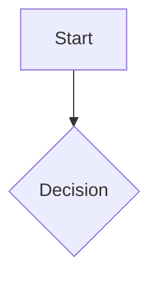

# Note Format Reference

Markdown notes are the unit of knowledge. This reference covers the structures the parser
understands.

---

## 1. Frontmatter

```markdown
---
title: "Descriptive name of the note"
category: resource      # resource | memory | skill
summary: "One or two sentences. This is what level-L0 retrieval returns."
tags:
  - topic-principal
  - subtopic
aliases:
  - Alternative name
status: ativo            # ativo | deprecated | draft
---
```

| Field | Required | Purpose |
| --- | --- | --- |
| `title` | yes | Identity used by `ListDocumentTitles` and by wikilink resolution. |
| `tags` | yes (vault notes) | Plain list, no `#`. |
| `summary` | strongly recommended | Micro-abstract for level-L0 retrieval. |
| `category` | recommended | Taxonomy filter (see §5). |
| `aliases` | optional | Resolves wikilinks written with an alternative name. |
| `status` | optional | Lifecycle flag. |

> [!tip]
> Write `summary` as if it were the only line anyone will ever read. That is usually true:
> L0 retrieval returns it alone, with no file read.

---

## 2. Wikilinks (graph edges)

Use `[[...]]` for internal references — **not** `[text](path.md)`, which produces no edge.

| Syntax | Effect |
| --- | --- |
| `[[Note]]` | Simple `links_to` edge. |
| `[[Note\|Label]]` | Edge with a custom display label. |
| `[[Note#Section]]` | Link to a specific section. |
| `[[Note#^block-id]]` | Block reference to one paragraph. |
| `[[#Section]]` | Same-note navigation; creates no edge. |
| `![[Note\|image.png]]` | Embed / transclusion. |

A `rel:` prefix names the **relation**, and the relation must be one the parser recognises
(`IsKnownRelation` in `internal/parser/wikilinks.go`). Recognised values:

| Value | Meaning |
| --- | --- |
| `links_to` | The default when no relation is given |
| `implements` `extends` `part_of` | Structural / design-relations |
| `depends_on` `supports` `refutes` | Logical relations |
| `derived_from` `fixes` `causes` | Provenance and causality |
| `related_to` `similar_to` | Soft relations |
| `tagged_as` | The relation the extractor gives to tag edges |

> [!warning]
> **An unrecognised relation is not a typed edge.** `[[rel:see_also:Z]]` looks like it should
> work; it does not — `see_also` is not in the recognised set, so the edge carries that
> relation name instead of being classified. If you want a soft cross-reference, use
> `[[rel:related_to:Z]]` or a plain `[[Z]]`.

> [!note]
> **Extracted edges all weigh 1.0.** The extractor hardcodes weight `1.0` for wikilink, tag
> and frontmatter-relation edges alike (`internal/parser/wikilinks.go:273,279,287`). There is no
> authored way to make one edge "weaker" than another; if you need graded provenance, encode it
> in the relation name or the note body, not in a numeric weight.

> [!example]
> Correct: `See [[Configuration]] for the precedence rules.`
> Wrong: `See [Configuration](./configuration.md) for the precedence rules.`

Resolution is case-insensitive and falls back through exact → substring → token matching.

> [!warning]
> **Architecture Decision Records are the documented exception** in this project: they use
> markdown links to their file paths, by long-standing convention.

---

## 3. Tags

**Frontmatter** — no `#`, lowercase kebab or snake case:

```yaml
tags:
  - cli
  - skill
  - howto
```

**Inline** — `#tag` in the body, for tags contextual to a paragraph:

```markdown
This document covers #fuzzy-matching and #parser in the vault context.
```

> [!warning]
> **Tags must resolve to a node, or they are dropped from the graph.** A conceptual tag with
> no matching document is removed by the tag resolver rather than becoming a node. To make a
> tag a real graph node, create a stub note whose `title` is exactly that tag. Without the
> stub, the tag stays searchable by full-text search but has no graph presence.

> [!warning]
> **Wrap tag syntax in inline code when documenting it.** Writing `` `#foo` `` documents the
> syntax; writing `#foo` bare in prose makes the parser capture it as a real tag. This applies
> to code blocks too — the parser reads the text, not the markdown semantics.

---

## 4. Callouts

```markdown
> [!note]
> Neutral observation.

> [!tip] Recommended practice
> Better, with a custom title.

> [!warning] Breaks something if ignored
> This breaks existing flows.

> [!important]
> Source of truth — resolve conflicts in favour of this.
```

| Type | Aliases |
| --- | --- |
| `note` | — |
| `abstract` | `summary`, `tldr` |
| `info` | — |
| `todo` | — |
| `tip` | `hint`, `important` |
| `success` | `check`, `done` |
| `question` | `help`, `faq` |
| `warning` | `caution`, `attention` |
| `failure` | `fail`, `missing` |
| `danger` | `error` |
| `bug` | — |
| `example` | — |
| `quote` | `cite` |

Consistent use makes notes scannable: `important` for what is authoritative, `warning` for what
breaks, `tip` for what to do instead.

Foldable and nested forms:

```markdown
> [!faq]- Collapsed by default
> [!faq]+ Expanded by default

> [!question] Outer
> > [!note] Inner
```

> [!tip]
> In this vault, use `summary` in frontmatter for the one-line abstract and reserve the `abstract`
> / `tldr` callout for the body. Frontmatter `summary` is what level-L0 retrieval returns; a
> callout of the same name is not.

---

## 4b. Obsidian syntax the parser does NOT index

> [!warning]
> These render correctly in Obsidian but produce **no graph edge and no searchable token**.
> The cleaner strips or ignores them before embedding. Use them for human eyes only, never as
> the sole carrier of information a reader should be able to retrieve.

| Syntax | Status | Consequence |
| --- | --- | --- |
| `==highlight==` | markers survive in chunk text | the word is still indexed; the `==` is noise |
| `%%hidden comment%%` | **not stripped** | commented-out text **is indexed and retrievable** — it looks deleted but is searchable |
| `![[embed]]` | embedded content not indexed | linking to a note only via an embed creates no edge |
| `---` horizontal rule | not stripped | cosmetic noise |
| `$$…$$` math | not stripped | notation is indexed as literal text |

Two consequences worth internalising:

1. **Comments are searchable.** `%%deprecated, do not use%%` will be returned by `mem search` as
   if it were current guidance. Delete stale knowledge; do not comment it out.
2. **An embed is not a link.** `![[Other Note]]` renders the content but creates no graph edge.
   To both display and link, write `![[Other Note]]` for the embed **and** a separate
   `[[Other Note]]` where the relationship is meant to be traversable.

> [!warning]
> The cleaner removes: markdown images, markdown links, bold/italic (both `*` and `_`),
> strikethrough, inline code, HTML tags, and the alias portion of `[[note|alias]]`. Anything
> outside that list is indexed verbatim.

---

## 5. Inline and block extras

Valid Obsidian syntax, indexed as literal text:

```markdown
==highlight==          highlighted text

Visible %%hidden%%      Obsidian-only inline comment
%%                      multi-line comment, hidden in reading view
$e^{i\pi}$              inline math
$$ ... $$              block math

- [ ] open task         task list checkbox
```

Mermaid diagrams render as code blocks and are stored as source text:

````markdown

````

> [!tip]
> `mem pack` emits a Mermaid diagram of the subgraph it packages, so a note that *describes*
> its relationships in prose does not need a hand-drawn diagram to be legible in context.

---

## 6. `category` taxonomy

| Value | Use for | Example |
| --- | --- | --- |
| `resource` | Persistent technical documentation | Architecture notes, audits |
| `memory` | Rules, habits, agent conventions | Quality principles |
| `skill` | Operational instructions and playbooks | Runbooks, guides |

Enables `mem search --category skill "..."` to retrieve only operational instructions,
separated from reference documentation.

---

## 7. Index pages (MOC)

Every folder gets a `README.md` that indexes its contents:

```markdown
---
title: "Folder name"
category: resource
summary: "Index of the <folder> folder: N notes about <what belongs here>."
tags:
  - navigation
  - <folder>
status: ativo
---

# Folder name

One paragraph defining what belongs in this folder — and what does not.

## Notes

- [[note-a]] - One-line summary of what it answers.
- [[note-b]] - One-line summary of what it answers.

## Related

- [[README]] - index one level up
```

The one-line summary is what makes the index useful to a reader — and to an agent doing a
cheap first pass before loading individual notes.

---

## 8. Embeds

Prefix a wikilink with `!` to inline the target's content:

```markdown
![[Note]]                 whole note
![[Note#Heading]]         one section
![[Note#^block-id]]       one block
![[image.png|300]]        image, width in pixels
![[image.png|640x480]]    image, explicit size
![[document.pdf#page=3]]  PDF at a page
![[Note.base#View]]       a saved view
```

> [!warning]
> **An embed renders content but creates no graph edge** (see §4b). If the relationship should
> be traversable, also write a plain `[[Note]]` where the link is meant to connect.

---

## 9. Encoding

> [!warning]
> **Accents are retrieval, not style.** Tokenisers treat `sao` and `são` as different tokens,
> so a search for one never matches the other. That is recall loss. It applies to `title` and
> `summary` exactly as it does to the body.

- UTF-8 **without BOM**. A BOM corrupts the first token of every note.
- Preserve the vault's existing line-ending convention.
- No stray non-Latin characters.

---

## 10. Writing a note with the CLI

```bash
mem note create <path> --title "Title" --tags "a,b" --type concept
mem note append <path> --heading "## Section" --content "..."
mem compile --topic "Topic" --out <path>
```

`--type` accepts `concept` (default), `decision`, `summary`, `entity`.

Flags available on `create`: `--title`, `--tags`, `--type`, `--aliases`, `--content`,
`--overwrite`, `--if-match <revision>`, `--vault`, `--db`, `--postgres`, `--repo`, `--storage`.

> [!note]
> Without `--content`, the body is read from stdin when a pipe is present — that is the normal
> path when a script or an agent generates the markdown.

> [!warning]
> When the target already has frontmatter, CLI flags are **merged**, not substituted. `title`
> and `type` from the CLI win; `tags` and `aliases` are unioned without duplicates; keys you did
> not pass (`category`, `summary`, …) are preserved.

> [!warning]
> `--if-match <revision>` is **accepted and validated but not yet enforced** on this code path.
> Do not rely on it for optimistic concurrency yet; verify before depending on it.

---

## 11. Checklist

- [ ] `title`, `category`, `summary`, `tags` present
- [ ] `[[wikilinks]]` rather than markdown links for internal references
- [ ] Every wikilink target actually exists
- [ ] `## Related` with 2–3 cross-links
- [ ] Entry added to the folder `README.md`
- [ ] UTF-8 without BOM, correct accents
- [ ] Retrievable — confirmed by an actual search hit
